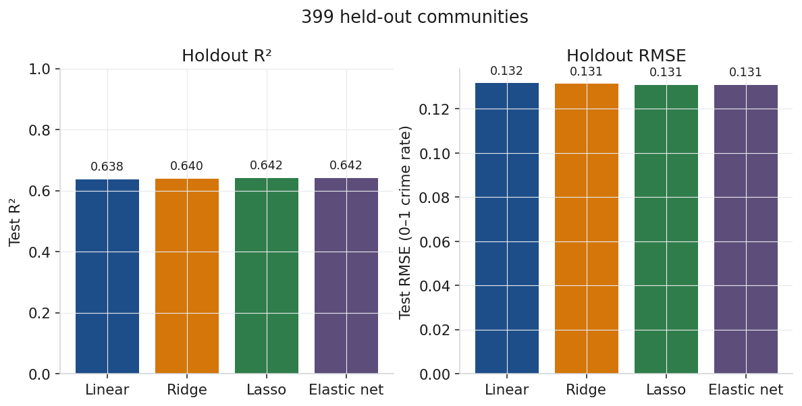

# Communities and Crime: least squares, ridge, lasso, and elastic net

Census columns from 1990 predict the 1995 violent-crime rate of 1,994 U.S. communities. Ridge, the lasso, and elastic net do not predict it better than ordinary least squares. They matter because many columns are near-copies, and least squares splits their weight in unstable ways.



| | |
| --- | --- |
| Printable report | [Communities_and_Crime_Report.pdf](Communities_and_Crime_Report.pdf) (21 pages) |
| Conference paper | [paper/main.tex](paper/main.tex), IEEE two-column, with [paper/references.bib](paper/references.bib) |
| Main split | 80/20, seed 42, 1,595 train / 399 test |
| Result | Test R² 0.638, 0.640, 0.642, 0.642. Five-split gap about 0.003, split-to-split spread about 0.03 |

The short version: all four models beat predicting the mean by a wide margin. None of the penalties is a meaningful accuracy upgrade on least squares. On the main split, elastic net chose an l1 ratio of 0.10, so it is mostly a ridge penalty, and it still drops 19 of the 100 features. Coefficients are associations. They are not effects of changing poverty, family structure, or racial composition.

## Data

`communities.data` has 1,994 communities and 128 attributes. `communities.names` is the UCI data dictionary, not just a readme.

The target is `ViolentCrimesPerPop`: violent crimes per population, built from murder, rape, robbery, and assault in the 1995 FBI Uniform Crime Reports. Every numeric attribute was already scaled to about 0–1, with values beyond three standard deviations clipped to 0 or 1. Errors below are on that normalized scale, not in crimes per 100,000.

The columns mix three sources: the 1990 Census, the 1990 LEMAS police survey, and the 1995 FBI crime counts.

The crime rate is right-skewed. Mean 0.24, median 0.15, skew 1.52. Most communities sit near the bottom of the scale.

## What we did

1. Dropped the five non-predictive fields: `state`, `county`, `community`, `communityname`, and `fold`. State is a nominal code, and the others are identifiers or a cross-validation tag. County and community are missing for about 59% of rows.
2. Dropped 22 LEMAS police-survey fields. Each one is missing for 1,675 of 1,994 communities (84%), because that survey covered larger departments plus a sample of smaller ones. Filling those in would invent a police force for most towns. `LemasPctOfficDrugUn` is complete, so it stayed.
3. Left 100 predictors. The only remaining gap is one missing `OtherPerCap` cell, filled with the training-set median inside the model pipeline.
4. Standardized the predictors after imputation, so the ridge, lasso, and elastic net penalties treat features on a common scale.
5. Held out 20% of communities (399 test, 1,595 train, seed 42). The penalty was chosen by 5-fold cross-validation on the training set only. Elastic net also searched l1 ratios 0.1, 0.5, 0.7, 0.9, and 0.95.
6. Fit four models: ordinary least squares, ridge, lasso, and elastic net.
7. Checked whether that ranking was a one-split accident by repeating the 80/20 cut on five seeds (0, 1, 7, 21, 42) and retuning the penalty each time.
8. Ran batch gradient descent on the same 100-feature training loss, and animated a one-feature line so the fit is visible.

## Results on the main split (seed 42)

Predicting the training mean scores test R² −0.022 and RMSE 0.221.

| Model | Penalty | Features used | Train R² | Test R² | Test adjusted R² | Test RMSE | Test MAE |
| --- | --- | --- | --- | --- | --- | --- | --- |
| Mean baseline | — | 0 | — | −0.022 | −0.022 | 0.221 | 0.179 |
| Linear | none | 100 | 0.701 | 0.638 | 0.516 | 0.132 | 0.094 |
| Ridge | α = 34.55 | 100 | 0.695 | 0.640 | 0.519 | 0.131 | 0.093 |
| Lasso | α = 0.000412 | 75 | 0.694 | 0.642 | 0.559 | 0.131 | 0.092 |
| Elastic net | α = 0.002424, l1 ratio = 0.10 | 81 | 0.697 | 0.642 | 0.550 | 0.131 | 0.093 |

All four cut RMSE by about 41% relative to the mean (0.221 down to about 0.131). On this one split the order by test R² is lasso 0.6421, elastic net 0.6418, ridge 0.6399, least squares 0.6379. The gap from first to last is 0.004. Adjusted R² makes the lasso look better (0.559 versus 0.516) because it is charged for 75 features instead of 100, on only 399 test rows. Elastic net is charged for 81 features, so its adjusted R² is 0.550.

## Are the penalties better?

A little, and not mainly because of accuracy.

Across five splits, with the penalty retuned on each training set. Elastic net searches the same five l1 ratios. The alpha grid on these repeats is coarser than the main split, so the selected alpha can differ. The test scores on seed 42 do not.

| Seed | Linear R² | Ridge R² | Lasso R² | Elastic net R² | Best |
| --- | --- | --- | --- | --- | --- |
| 0 | 0.6588 | 0.6583 | 0.6512 | 0.6501 | Linear |
| 1 | 0.6091 | 0.6110 | 0.6125 | 0.6113 | Lasso |
| 7 | 0.6749 | 0.6806 | 0.6789 | 0.6780 | Ridge |
| 21 | 0.6768 | 0.6807 | 0.6771 | 0.6804 | Ridge |
| 42 | 0.6379 | 0.6400 | 0.6422 | 0.6417 | Lasso |
| Mean | 0.6515 | 0.6541 | 0.6524 | 0.6523 | Ridge |

Mean test RMSE is 0.1351, 0.1346, 0.1349, and 0.1349 for linear, ridge, lasso, and elastic net. The average R² gap is about 0.003. The standard deviation from one split to another is about 0.03, ten times larger. Ridge has the best average and wins two seeds. Lasso wins two, including the original seed-42 split. Least squares wins seed 0. Elastic net wins none. On four of the five seeds it selects l1 ratio 0.1; on seed 7 it selects 0.5.

So if the goal is prediction alone, the four models are tied for practical purposes. All of them explain a bit more than 60% of the holdout variance. None of them is a large upgrade on the others.

Where the penalties are actually better:

- The features overlap. 49 predictor pairs correlate at 0.90 or above. 64 of 100 features have a variance-inflation factor above 10, and the median VIF is 21.6. `TotalPctDiv` is effectively a copy of the other divorce measures, so its VIF is infinite.
- Least squares then assigns huge opposite weights to those copies. `PctRecImmig8` and `PctRecImmig10` correlate at 0.996 and get standardized coefficients of +0.128 and −0.080. `TotalPctDiv` correlates at +0.55 with crime, but its least-squares coefficient is −0.128.
- Ridge shrinks those weights. Lasso and elastic net set the redundant copies to zero. On the main split the lasso keeps 75 of 100 features. Elastic net, at l1 ratio 0.10, keeps 81 and still zeros `TotalPctDiv`, `PctRecImmig10`, and `PctHousOwnOcc`. The signs that match the raw correlations, such as `PctKids2Par` (negative) and `PctIlleg` (positive), survive.
- Least squares also fits the training set a bit harder (train R² 0.701 versus 0.695 for ridge, 0.694 for the lasso, and 0.697 for elastic net) and gives a little of that back on the test set.

Use least squares if you only need a prediction and want the simplest fit. Use ridge if you want every feature kept and the weights calmed down. Use the lasso if you want the shorter model. Use elastic net when you want the mix cross-validation actually chose: here that mix is mostly ridge, with a little feature selection. Do not expect a large drop in error from any of the three penalties.

These coefficients are associations. Family structure, poverty, and racial composition move together, so a coefficient is not the effect of changing that one variable.

## What tracks the crime rate

The strongest Pearson correlations with `ViolentCrimesPerPop`, on all 1,994 communities:

| Feature | Correlation |
| --- | --- |
| PctKids2Par | −0.74 |
| PctIlleg | +0.74 |
| PctFam2Par | −0.71 |
| racePctWhite | −0.68 |
| PctYoungKids2Par | −0.67 |
| PctTeen2Par | −0.66 |
| racepctblack | +0.63 |
| pctWInvInc | −0.58 |
| pctWPubAsst | +0.57 |
| FemalePctDiv | +0.56 |

Communities with more children in two-parent households have lower crime rates in this file. Communities with a higher share of births to unmarried parents have higher rates. Those two features are themselves strongly related, which is why the heatmap shows blocks rather than isolated causes.

A partial coefficient can flip sign once the overlapping features are in the model. `PctPopUnderPov` correlates at +0.52 with crime, but the lasso coefficient is slightly negative. That is shared variance, not evidence that poverty lowers crime.

## Gradient descent, and the fitting animation

Ordinary least squares is a closed-form solve, so it never shows the weights moving. Batch gradient descent minimizes the same training mean squared error, starting from all-zero weights.

On the 100 standardized features, the largest stable learning rate is 0.040.

- Learning rate 0.032 (80% of that limit) drops training MSE from 0.115 to 0.017 within about 100 steps, matching the least-squares loss of 0.0167. After 5,000 steps the loss has arrived, but the weight vector is still 0.20 away from the least-squares weights. The loss is flat in directions where features are copies, so the weights keep crawling after the error has stopped falling. Holdout RMSE of this run is 0.132, the same as closed-form least squares.
- Learning rate 0.006 gets to the same loss more slowly.
- Learning rate 0.054 diverges within about 10 steps.

The full model is a hyperplane in 100 dimensions, so it cannot be drawn as one line. `figures/15_line_fitting.gif` is the same update on the single strongest feature, `PctKids2Par`, using the 1,595 training communities. The line starts with the wrong tilt (slope +0.90) and rotates onto the least-squares line (slope −0.84, intercept 0.76) over 188 steps. Training MSE on that one feature falls from 0.283 to 0.025. Open the gif to watch it. Stills of the start, middle, and end are `16_line_fit_start.png`, `17_line_fit_middle.png`, and `18_line_fit_end.png`.

The two contour plots show the same idea in a pair of weights. On `PctKids2Par` and `PctIlleg` the path slides along a valley because the features overlap. On `racepctblack` and `pctWInvInc` the bowl is rounder and the path is shorter.

The canvas next to the analysis also has step buttons (Start, 10, 25, 100, 1,000, 5,000) for four of the full-model weights.

## Figures

| File | What it shows |
| --- | --- |
| `figures/01_target_distribution.png` | Crime-rate histogram |
| `figures/02_missing_values.png` | Police fields missing for 84% of communities |
| `figures/03_correlation_with_target.png` | Strongest correlations |
| `figures/04_correlation_heatmap.png` | Those predictors move together |
| `figures/05_feature_scatters.png` | Six strongest features against the crime rate |
| `figures/06_holdout_metrics.png` | Test R² and RMSE |
| `figures/07_predicted_vs_actual.png` | Holdout predictions against the diagonal |
| `figures/08_residuals.png` | Residual scatter and histograms |
| `figures/09_coefficients.png` | Least squares versus ridge, lasso, and elastic net |
| `figures/10_gradient_descent_loss.png` | Slow versus chosen learning rate |
| `figures/11_gradient_descent_weights_vs_loss.png` | Loss flattens while weights keep moving |
| `figures/12_gradient_descent_coefficient_paths.png` | All 100 weights leaving zero |
| `figures/13_gradient_descent_contour_family.png` | Descent on two overlapping family features |
| `figures/14_gradient_descent_contour_bowl.png` | Descent on a rounder pair of features |
| `figures/15_line_fitting.gif` | One-feature line rotating onto the data |
| `figures/16_line_fit_start.png` | Animation, first frame |
| `figures/17_line_fit_middle.png` | Animation, middle frame |
| `figures/18_line_fit_end.png` | Animation, line on the least-squares fit |

## Conference paper

`paper/main.tex` is the Overleaf source. Upload this repository, set the main file to `paper/main.tex`, and compile with pdfLaTeX. The paper uses `figures/06_holdout_metrics.png` and `figures/09_coefficients.png`.

The claim in that paper is the one to cite: on this file the penalty barely moves holdout error, and least squares puts opposite signs on columns that correlate at 0.996 (`PctRecImmig8` and `PctRecImmig10`).

## How to rerun

From this folder, with Python 3.11 and the installed scientific stack (`numpy`, `pandas`, `scikit-learn`, `matplotlib`, `pillow`):

```bash
python crime_regression.py
python plot_analysis.py
python animate_fit.py
python build_report.py
```

`crime_regression.py` writes `analysis_results.json`. `plot_analysis.py` writes the still figures and `figures/gd_canvas.json`. `animate_fit.py` writes the gif, the three stills, and `figures/comparison.json`. Add `--animation-only` to rebuild the gif without refitting the five splits. `build_report.py` needs `reportlab` and rewrites the PDF.

## Files

| File | Role |
| --- | --- |
| `communities.data` | Raw data, `?` means missing |
| `communities.names` | UCI attribute dictionary |
| `crime_regression.py` | Cleaning, EDA summaries, the four models |
| `plot_analysis.py` | Still figures and full-model gradient descent |
| `animate_fit.py` | Line-fitting animation and the five-split check |
| `build_report.py` | Builds the 21-page PDF from the JSON and figures |
| `analysis_results.json` | Metrics, correlations, coefficients |
| `figures/` | Plots, the gif, and `comparison.json` |
| `paper/main.tex` | Conference-paper source |
| `Communities_and_Crime_Report.pdf` | Long printable report |

The UCI file is included so the scripts rerun without a download. `?` in `communities.data` means missing. The dictionary is `communities.names`.

## Citation

Himanshu (2026). Ridge, lasso, and elastic net do not beat least squares on the UCI Communities and Crime data. https://github.com/HIMANSHUMOURYADTU/Research_lasso
